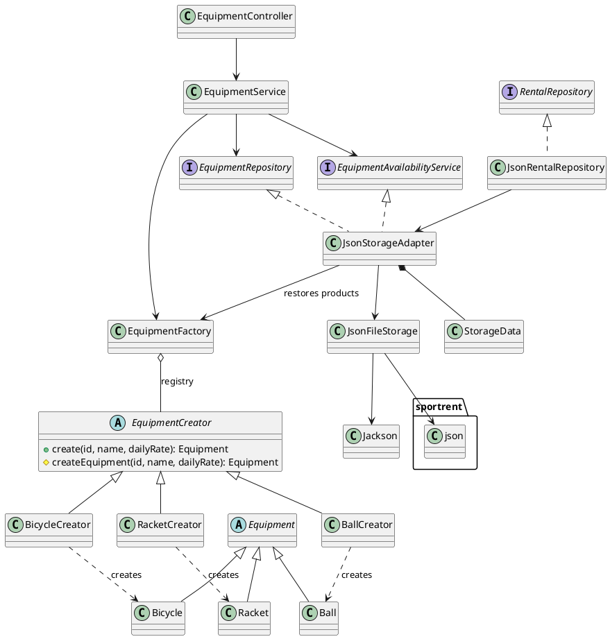

# Участник 1 — Дамир К: каталог и хранение SportRent

Работа выполнена в ветке `Damir`. Основа — общий каркас из `main`, коммит `c5aa619`.
Модули расчёта, оформления аренды и отчётов не реализованы в этой части.

## Что сделано

- Каталог трёх типов инвентаря: велосипед, мяч и ракетка. Каждая запись — отдельный физический предмет.
- Создание, просмотр, изменение названия и суточной цены, удаление с подтверждением.
- Серверные фильтры по типу и доступности; подсказка по использованию каждого типа.
- Доступность вычисляется по `ACTIVE`-арендам. В модели и JSON нет флага `available`.
- Занятый предмет нельзя изменить, удалить или сохранить для него вторую активную аренду.
- Тип существующего предмета нельзя изменить. Снимки завершённых аренд сохраняются после изменения и удаления предмета.
- Два репозитория используют один файл `data/sportrent.json`. Девять демонстрационных предметов, по три каждого типа, создаются только при отсутствии файла.
- Русская страница `/catalog.html`: загрузка, пустой результат, ошибки, повторный запрос, сохранение черновика при отказе сервера, мобильная вёрстка.

## Factory Method

Проблема: при создании предмета и восстановлении из JSON нужен правильный подкласс с собственной подсказкой, но сервис каталога не должен создавать продукты напрямую.

`EquipmentCreator.create()` проверяет название и цену, обрезает пробелы и округляет цену через `BigDecimal.setScale(2, HALF_UP)`. Затем вызывает переопределяемый фабричный метод `createEquipment()`.

- `BicycleCreator` создаёт `Bicycle`.
- `BallCreator` создаёт `Ball`.
- `RacketCreator` создаёт `Racket`.
- Общая база продуктов — существующий `shared.model.Equipment`.
- `EquipmentFactory` выбирает создателя из реестра по `EquipmentType`.

Это Factory Method, потому что конкретный продукт определяется переопределённым методом подкласса создателя. Реестр только выбирает создателя; сам по себе он не является реализацией паттерна.

Демонстрация: добавить по одному предмету каждого типа и показать разные подсказки в карточках. Затем открыть `EquipmentCreator` и конкретные создатели.

## Adapter

Проблема: бизнес-модулям нужны операции репозиториев, а файловый механизм работает с Jackson, путём и полным JSON-документом.

Цепочка вызова: `EquipmentRepository` / `RentalRepository` → адаптеры → `JsonFileStorage` → Jackson и файловая система.

- `JsonStorageAdapter` реализует `EquipmentRepository` и `EquipmentAvailabilityService`, хранит согласованное состояние каталога и аренд.
- `JsonRentalRepository` реализует `RentalRepository` и передаёт операции тому же `JsonStorageAdapter`.
- `StoredEquipment` содержит только `id`, `type`, `name`, `dailyRate`. При чтении продукт восстанавливается через фабрики.
- `StorageData` объединяет списки `equipment` и `rentals`.
- `JsonFileStorage` читает JSON и записывает весь документ через временный файл в той же папке и атомарную замену.

В общем контракте оба репозитория имеют `findAll()` и `findById(UUID)`, но возвращают разные типы. Java не позволяет одному классу реализовать такие методы одновременно. Поэтому использованы два входа в адаптер с одним хранилищем. Сигнатуры общих интерфейсов не изменены.

Все операции с состоянием синхронизированы на одном экземпляре `JsonStorageAdapter`. Проверка занятости и запись новой аренды выполняются под той же блокировкой. Память обновляется только после успешной записи файла. Ошибка записи не создаёт ложного успешного результата.

Демонстрация: добавить предмет, перезапустить приложение и найти его с прежним ID. Показать JSON без имён Java-классов, `available` и `usageHint`. Для демонстрации повреждённого файла использовать отдельную копию хранилища: запуск должен завершиться диагностической ошибкой, не заменяя файл демоданными.

## Основные файлы

| Файлы | Назначение |
|---|---|
| `catalog/EquipmentCreator`, три создателя и три продукта | Factory Method |
| `catalog/EquipmentFactory` | Реестр создателей |
| `catalog/EquipmentController` | HTTP-маршруты; не обращается к файлу |
| `catalog/EquipmentService` | CRUD, фильтры, проверка возможности изменения, ответы DTO |
| `catalog/EquipmentRequestReader` | Строгий разбор тела запроса каталога без изменения общего ObjectMapper |
| `storage/JsonStorageAdapter`, `JsonRentalRepository` | Репозитории, доступность, согласованность записи |
| `storage/JsonFileStorage` | Jackson и атомарная замена файла |
| `storage/StoredEquipment`, `StorageData`, `DemoEquipment`, `StorageException` | Формат данных, начальные записи, ошибки |
| `static/catalog.html`, `static/css/catalog.css`, `static/js/catalog.js` | Интерфейс каталога |
| `src/test/java/com/sportrent/catalog`, `src/test/java/com/sportrent/storage` | Тесты модуля |

Java-файлы расположены под `src/main/java/com/sportrent`, статические — под `src/main/resources`.

## API и валидация

| Запрос | Результат |
|---|---|
| `GET /api/equipment` | `200`, массив `EquipmentResponse` |
| `GET /api/equipment?type=BALL&available=true` | `200`, только свободные мячи; оба фильтра необязательны |
| `GET /api/equipment/{id}` | `200`, один предмет |
| `POST /api/equipment` | `201`, созданный предмет и заголовок `Location` |
| `PUT /api/equipment/{id}` | `200`, изменённый предмет |
| `DELETE /api/equipment/{id}` | `204`, пустое тело |

Тело POST/PUT:

```json
{"type":"BICYCLE","name":"Велосипед №4","dailyRate":1000.00}
```

Название: 2–100 символов после удаления крайних пробелов. Цена: 0.01–1 000 000.00 KZT. Сервер округляет разрешённую цену до двух знаков. Форма принимает шаг 0.01. Неизвестный тип, числовой enum, нечисловая цена, некорректный UUID и неверные фильтры отклоняются.

Используется общий формат `{code, message, fieldErrors}` и общий обработчик ошибок. Коды: `VALIDATION_ERROR`, `EQUIPMENT_NOT_FOUND`, `EQUIPMENT_IN_USE`, `EQUIPMENT_UNAVAILABLE`, `EQUIPMENT_CHANGED`, `RENTAL_ALREADY_COMPLETED`, `STORAGE_ERROR`. Ошибки полей показаны возле соответствующих полей. Пользовательские строки выводятся через `textContent`.

## Запуск и проверки

Нужен JDK 21. Spring Boot остаётся **3.5.0**, Maven Wrapper — **3.9.9**, как в общем каркасе. При необходимости задайте `JAVA_HOME` на установленный JDK 21.

```bash
sh mvnw spring-boot:run
# Windows: mvnw.cmd spring-boot:run
```

Открыть <http://localhost:8080/catalog.html>. Используется тот же Java-сервер, что и для API.
В общем каркасе `mvnw` не имеет исполняемого бита, поэтому на macOS/Linux указана команда с `sh`.

```bash
sh mvnw clean verify
# Только проверки участника 1:
sh mvnw -Dtest=EquipmentFactoryTest,EquipmentApiTest,JsonStorageAdapterTest,StorageConsistencyTest test
# Запуск собранного приложения:
java -jar target/sportrent-0.1.0-SNAPSHOT.jar
# Отдельный файл для ручной демонстрации:
java -jar target/sportrent-0.1.0-SNAPSHOT.jar --sportrent.storage.path=data/demo-sportrent.json
```

Не добавляйте пользовательские JSON-файлы в Git. Настройка `sportrent.storage.path` уже существует в `application.properties`; менять исходный файл конфигурации не требуется.

### Фактические результаты — 15 ноября 2026

`clean verify` выполнен с Temurin **21.0.13** через Maven Wrapper. Получен запускаемый JAR. **34 запуска JUnit: 0 ошибок, 0 падений, 0 пропусков**. Из них 33 — проверки этого модуля, один — существующий `contextLoads` каркаса.

| Набор | Количество | Что проверяет |
|---|---:|---|
| `EquipmentFactoryTest` | 2 | Конкретные продукты, подсказки, округление, неверные названия и цены |
| `JsonStorageAdapterTest` | 13 | Первичная инициализация, загрузка обоих списков, снимки, пустой каталог, повреждённый файл, отказ записи, дубли |
| `StorageConsistencyTest` | 4 | Занятость, возврат, неизменность типа, устаревший снимок, конкурентные записи |
| `EquipmentApiTest` | 14 | Реальный Spring-контекст и MockMvc: CRUD, фильтры, HTTP-статусы и валидация |
| `SportRentApplicationTests` | 1 | Запуск общего Spring-контекста |

Количество включает отдельные запуски параметризованных тестов. Файловые тесты используют `@TempDir`. Аренды для тестов создаются только в тестовых данных; производственных заглушек нет.

| Сценарий | Входные данные / действие | Ожидаемый результат | Фактический результат | Статус |
|---|---|---|---|---|
| Создание и восстановление | «Мобильная проверка», 1250.50 KZT; обновить страницу | Новый предмет остаётся в каталоге | Карточка восстановлена, количество выросло на 1 | Пройден, браузер |
| Изменение и отмена | Изменить имя; сначала отменить, затем сохранить | Отмена не меняет запись, сохранение меняет её | Оба варианта проверены, тип заблокирован | Пройден, браузер |
| Удаление | Отменить подтверждение, затем подтвердить | Сначала предмет остаётся, затем исчезает | Оба результата получены | Пройден, браузер |
| Фильтры | `BALL`; затем только занятые при отсутствии занятых мячей | Три мяча; затем пустой список | Получены три карточки и сообщение о пустом результате | Пройден, браузер |
| Перезапуск процесса | Создать ракетку за 777.77 KZT; остановить Java и запустить JAR с тем же файлом | Сохраняются ID, название, тип и цена | Ответ GET после перезапуска совпал с исходным | Пройден, HTTP + перезапуск |
| Занятый предмет | Одна ACTIVE-аренда в отдельном файле демонстрации | Недоступен; изменение/удаление запрещены | Две кнопки отключены, DELETE вернул 409; API-тест также проверил PUT | Пройден, браузер + HTTP/JUnit |
| Ошибка сети | В браузерном контексте отключить сеть, затем включить и обновить | Понятное сообщение и успешный повтор | Каталог восстановлен после «Обновить» | Пройден, браузер |
| Ошибка сохранения | Перехват POST с тестовым ответом 500 `STORAGE_ERROR` | Нет сообщения об успехе; черновик сохранён | Имя и цена остались, кнопка снова доступна | Пройден, браузер; отказ файловой записи отдельно проверен JUnit |
| Неверный ввод | Пустые поля; запрос с `type: 1` | Пустая форма не отправляется; API возвращает 400 | Оба результата получены | Пройден, браузер + HTTP |
| Безопасный текст и доступность | Название с ``; Tab между полями; ширины 1280 и 390 px | Текст не исполняется, фокус виден, нет горизонтального переполнения | Проверено; ошибок JS/консоли в последней штатной проверке нет | Пройден, браузер |

Также выполнены `node --check src/main/resources/static/js/catalog.js` и `git diff --check`.

## Вклад в UML

Ниже фрагмент диаграммы классов участника 1 для общей диаграммы Даниала. Сущности и контракты из `shared` принадлежат общему каркасу.



Для общей диаграммы последовательности оформления: модуль №3 вызывает `RentalRepository.save(rental)` после расчёта и сборки аренды. `JsonRentalRepository` передаёт вызов в `JsonStorageAdapter`; под общей блокировкой проверяются доступность и актуальность снимка, затем `JsonFileStorage` записывает оба списка и заменяет файл. Только после успешной записи возвращается сохранённая аренда. Публикация события после этого возврата — ответственность участника №3.

## Интеграция и ограничения

- Общие модели, DTO, интерфейсы, версии, README и чужие модули не изменялись. Spring автоматически подключает реализации из `catalog` и `storage`.
- Участнику №3 нужно внедрить `EquipmentRepository`, `RentalRepository`, `EquipmentAvailabilityService` по существующим сигнатурам. Сохранение новой аренды принимает `ACTIVE`; обновление разрешает завершение через `original.completedAt(time)` с прежними условиями. Повторное завершение возвращает 409. Финальная проверка занятости выполняется в хранилище, даже если вызывающий сервис уже её проверил.
- Если каталог изменён между предварительным расчётом и сохранением аренды, возвращается `EQUIPMENT_CHANGED`: обновить предмет и пересчитать стоимость. Цену хранилище не рассчитывает.
- `EquipmentAvailabilityService` в общем документе ещё помечен как предложение. Реализация готова; Дамиру и Артему нужно подтвердить этот существующий контракт перед объединением.
- Участнику №4 нужно отразить модуль в README и общей UML. В текущей модели `Customer` нет `id`, хотя он указан в первоначальном ТЗ: согласование модели остаётся за владельцем общего каркаса. Модуль хранения сохраняет действующую модель без изменения контракта.
- Сейчас отсутствуют страницы и API участников №2–4, кроме общей главной страницы. Ссылки на них сохранены для интеграции; полный сценарий оформления, расчёт и отчёт здесь не заявляются проверенными.
- Хранилище рассчитано на один процесс приложения и один Spring-экземпляр адаптера. Одновременная работа нескольких процессов с одним файлом не поддерживается. Файл загружается при запуске; внешнее редактирование во время работы не поддерживается.
- Нужна файловая система с атомарной заменой. Если операция недоступна или файл повреждён, возникает понятная ошибка, без автоматической замены демоданными. Восстановление из резервной копии выполняется вручную при остановленном приложении.
- Дополнительных библиотек, базы данных, авторизации и localStorage нет. Push не выполнялся.

## Что понимать на защите

1. Чем абстрактный создатель отличается от продукта, где вызывается переопределяемый фабричный метод и зачем реестр типов.
2. Как репозиторий скрывает Jackson и файловую систему; почему здесь два интерфейса требуют двух адаптеров.
3. Почему `BigDecimal` нужен для денег и где применяется `HALF_UP`.
4. Почему доступность вычисляется по арендам, а `equipmentSnapshot` сохраняет старые данные.
5. Почему проверка и запись должны находиться под одной блокировкой; как временный файл защищает основной.
6. Как `fetch`, HTTP-статусы, `fieldErrors` и `textContent` участвуют в интерфейсе.

Небольшое изменение для защиты: изменить подсказку `Bicycle.getUsageHint()` и показать результат после перезапуска. Другой пример — поменять начальную цену мяча в `DemoEquipment` и объяснить, почему существующее хранилище от этого не изменится; проверить на отдельном новом файле.

## Использованные инструменты

Код, тесты и пояснения подготовлены с помощью OpenAI Codex. Использованы Git, Maven Wrapper, JUnit 5, Spring MockMvc, Temurin JDK 21 и Playwright для браузерных проверок; Python — для временных проверочных HTTP-запросов и тестовых данных. Дополнительные ИИ-агенты для этой части не запускались. Перед защитой участник должен самостоятельно разобрать классы и воспроизвести проверки.

При проверке файловых операций и тестового окружения использована официальная документация: [Java 21 Files](https://docs.oracle.com/en/java/javase/21/docs/api/java.base/java/nio/file/Files.html), [Spring Boot — testing applications](https://docs.spring.io/spring-boot/3.5/reference/testing/spring-boot-applications.html). Код использует версии, зафиксированные в каркасе.
